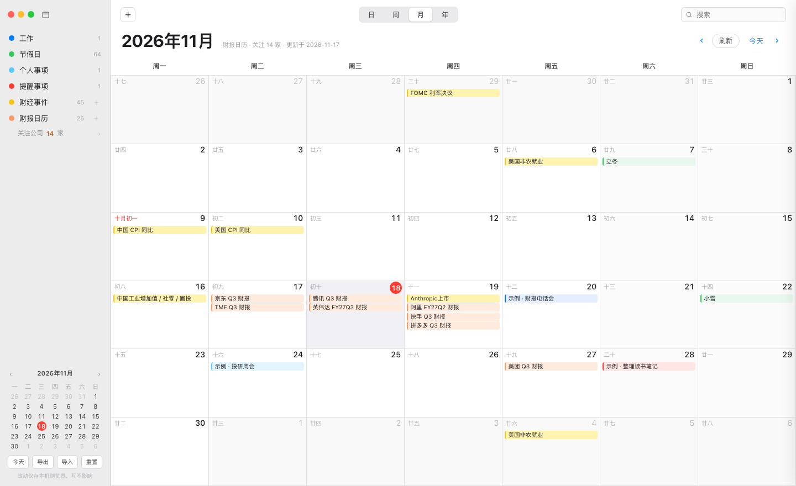

# 财经日历 · fincal

一个可以完全自己拥有的财经日历。零依赖单文件，双击即开；财经事件跟着官方发布日程走，财报公布后自动比对预期与股价。



## 为什么做这个

市面上的财经日历分两种：一种是网站（investing.com、金十、TradingView），数据全但不能改，你的关注清单、你的财报日、你的备注都留不下；另一种是 GitHub 上的 ICS 生成器，能自动更新，但只在"改配置文件"这个层面可编辑，而且订阅到系统日历后就是只读的——想改一条，就得放弃自动更新。

这个项目想把三件事放进同一个界面：

- **官方数据**（发布日程、公布值）由 `scripts/` 从官方站点抓下来，落在 `data/*.json`，可版本管理
- **你的改动**（加公司、改关注点、订阅哪些事件、写解读）在界面里完成，存 localStorage，随时导出备份
- **你的判断**（公司关注点、数据解读）永远盖在自动数据上面

改内置数据不会动你的改动，抓取失败也不会把上次的数据冲掉。

## 功能

**四个视图**：月 / 周 / 日 / 年，今天回跳，左右翻页，农历标注（初一红字、节气）。

**手机能直接用**：窄屏下侧栏收进左上角 ☰，月视图格子只留日期 + 分类圆点（点开当天看清单），周视图改成竖排议程，详情抽屉变成底部面板。电脑和手机打开的是同一个文件，各自存各自的改动。

**哪一版**：侧栏底部常驻一行「构建 2026-11-18 · 日程 2026-11-18」，前者是页面构建日期，后者是官方日程快照日期，对一眼就知道手上这份是不是最新。

**事件编辑**：点日期或事件打开右侧抽屉，可改标题、日期、起止时间、全天、分类、提前提醒。双击空白格直接新建。提醒用浏览器 Notification，页面开着时生效。

分类六个都能选：工作 / 节假日 / 个人事项 / 提醒事项 / 财经事件 / 财报日历。自建事件也可以归到「财经事件」「财报日历」——只是不会带官方日程那套只读详情（公布值、预期对比），点开还是这个编辑表单。

**财经事件：订阅官方日程**
- 左侧「财经事件」→ `+`，27 个模板按国家分组：美国 CPI / PPI / 非农 / JOLTS / 进出口价格 / 核心 PCE / 零售 / 贸易帐 / GDP / FOMC；中国 CPI / PPI / 工业增加值社零 / 官方 PMI / 工业企业利润；再加欧央行、日本央行等无固定日程的
- 每行直接标出「官方 14 期 · 下期 12-10」，点「订阅」即进日历
- 日期来自 `scripts/fetch_schedule.py` 抓的官方发布计划，统一换算成北京时间，官方改期后重新抓一次就跟着变
- 没有稳定官方日程的（社融、LPR、ISM、EIA、初请），保留「按频次铺开」的手工模式，每条标注是手工估计

**公布结果与解读**：已公布的那一期，详情页多出一块「公布结果」——官方公布值、前值、变化，下面是自己写的解读，再下面是脚本按「本期 vs 上期」自动生成的事实摘要。数字来自官方新闻稿，解读可以自己改。

**财报日历**：左侧「财报日历」→ `+` 添加公司。
- 填公司名或代码（`NVDA` / `3690.HK` / `600519`），自动识别市场
- 命中内置资料库就带出业务结构与关注点；没命中生成空白模板并直接打开表单
- 每家公司可加多个财报日，也可删掉整个公司（可恢复）

**财报详情页**：市场预期（目标价 / 潜在空间 / 评级分布）、业绩预期、核心业务关注点、实际业绩、股价表现。
- **实际业绩**：实际 vs 预期逐项对比，自动判定「超预期 / 符合预期 / 低于预期」（阈值 ±2%，优先看 EPS），标出预期差
- **股价表现**：财报前收、当日涨跌、次日涨跌（红涨绿跌，A 股口径）
- 没有数据时给按钮，能录、能抓、也能导入

**详情页两种填写方式**（公司资料 / 财报数据都能这样填）：
- **根据我的文件夹**：拖入或选文件，支持 `.json / .csv / .md / .txt`，可整目录遍历；也能读项目里 `userdata/` 下的档案。文件名、代码、业务结构、关注点、财报日、EPS 都能识别
- **根据网上获取**：填官网 IR 页链接或股票代码，直连抓不到时用自建 CORS 代理；还是抓不到就粘贴正文，页面自己抽数字
- 两个入口都是先预览识别结果，确认后写入；写进去之后照样能手动改

**右上角「刷新」**：重新拉一遍 `data/` 下的日程、公布结果、业绩、行情，顺手抓两家缺行情的公司，然后整体重绘。部署成网站时每天由 GitHub Actions 自动跑一遍。

**导入导出**：左下角三个按钮。导出含事件、隐藏分类、公司覆盖表、订阅列表、录入的业绩与解读。

**移动端**：侧栏收起，工具栏保留「财经」入口，点标题下「财报日历 · 关注 N 家」进公司管理，点日期进抽屉。抽屉全屏。

## 用起来

**方式一：直接打开**

下载仓库，双击 `index.html`。不需要服务器、不需要 npm。离线可用，此时刷新按钮只会重绘（拉不到 `data/*.json`）。

**方式二：GitHub Pages（推荐，能自动更新）**

Fork → Settings → Pages → Source 选 `Deploy from a branch`，分支 `main`，目录 `/ (root)`。访问 `https://<你的用户名>.github.io/fincal/`。

仓库自带 `.github/workflows/update.yml`，每天 07:20（北京时间）抓一次官方日程、公布结果、股价反应，重建 `index.html` 并提交。开着 Pages 就是每天自动更新的日历，不用管。

**方式三：本地维护**

```bash
git clone https://github.com/<你>/fincal.git
cd fincal
python3 scripts/fetch_schedule.py     # 官方发布日程
python3 scripts/fetch_releases.py     # 宏观数据公布值
python3 scripts/fetch_quotes.py       # 财报次日股价
python3 src/build.py                  # 重新生成 index.html
```

四个脚本都只用 Python 3 标准库，没有第三方依赖。

## 数据从哪来

| 来源 | 抓什么 | 稳定性 |
|---|---|---|
| 美联储 FOMC 日历 | 2026 / 2027 全部议息会议 | 稳定，HTML 表格 |
| 美国劳工统计局（BLS） | CPI / PPI / 非农 / JOLTS / 进出口价格的全年日程 | 稳定；对数据中心 IP 有反爬，Actions 或本机跑没问题 |
| 美国经济分析局（BEA） | 核心 PCE / GDP / 贸易帐 | 稳定 |
| 美国人口普查局 | 零售销售 | 页面只给「下次发布」，且反爬较严，常失败 |
| 国家统计局 | 11 类月度发布日程 + 新闻稿里的公布值 | 稳定 |
| Yahoo Finance | 财报次日股价 | 公开接口，无 key |

抓不到某个来源时的处理是固定的：**保留上一次的条目，不猜**。`data/schedule.json` 的 `sources[].ok` 会标 false，页面顶部状态条显示「N 个来源不可用」。

## 数据文件

`data/` 下八个 JSON，都可手改（改完跑一次 `python3 src/build.py`）。

| 文件 | 内容 | 谁维护 |
|---|---|---|
| `schedule.json` | 官方发布日程，日期时间已换算成北京时间 | `fetch_schedule.py` |
| `releases.json` | 已公布事件的公布值与事实摘要，`read` 字段放人工解读 | `fetch_releases.py`（不覆盖 read） |
| `earnings.json` | 财报日程：日期、代码、公司、盘前盘后、confirmed / estimated、市场预期 | 人 |
| `companies.json` | 公司资料：业务结构 + 核心关注点 | 人 |
| `actuals.json` | 财报实际业绩，key 为股票代码 | 人 / 页面录入 |
| `quotes.json` | 财报当日与次日涨跌 | `fetch_quotes.py` |
| `events.json` | 普通事件种子（节假日、示例个人事项） | 人 |
| `finance.json` | 公共财经事件（IPO、并购等个案） | 人 |
| `macro.json` | 事件模板库，`auto:true` 表示有官方日程源 | 人 |

一条财报：

```json
{
  "d": "2026-11-19",
  "ticker": "NVDA",
  "company": "英伟达",
  "title": "英伟达 FY27Q4 财报",
  "status": "estimated",
  "note": "美股盘后，北京时间次日 05:00",
  "src": "公司 IR"
}
```

一条公布结果（key 是 `模板id@公布日`）：

```json
"cn-cpi@2026-11-09": {
  "tid": "cn-cpi", "d": "2026-11-09",
  "vals": [{ "k": "CPI 同比", "v": 0.7, "u": "%" }],
  "auto": "CPI 同比 +0.7%，较前值 0.9% 回落 0.2 个百分点。",
  "read": "同比 0.7%，连续四个月在 1% 以下……",
  "src": "国家统计局"
}
```

## 设计上的三个决定

**官方日程要抓，不要编。** 上一版这里写的是"不内置具体日期"——因为手写死会过期，写"大概每月 12 号"就是编造。现在换成了第三种做法：从官方页面抓。抓得到就用真的，抓不到就不显示，绝不猜。所以你会看到 BLS 和人口普查局有时标红不可用，那是诚实，不是 bug。

**用户数据永远优先。** 公司资料、解读、订阅列表都存在浏览器里，`data/*.json` 只是默认值。抓取脚本重写数据文件时，`read` 字段（你写的解读）不会被覆盖；重新构建也不会动 localStorage。自动数据和手工编辑撞车时，赢的是你。

**数字和解读分开。** 脚本只产出数字和事实摘要（"较前值回落 0.2 个百分点"这种能算出来的话），观点性的判断留空给人写。宁可空着，也不要一段机器生成的、看起来很专业但没人负责的评论。

## 边界

- **没有后端**。数据在你的浏览器 localStorage 里，换设备、清缓存会丢，所以有导出。
- **联网是可选的**。直接打开 `index.html` 时完全离线；部署成网站后才会自取 `data/*.json`。抓行情和抓网页受跨域限制，需要自建一个 CORS 代理前缀。
- **提醒不可靠**。浏览器 Notification 只在页面开着时生效。
- **覆盖率不完整**。中国社融、LPR，美国 ISM、初请、EIA 库存这些没有稳定的机器可读日程，只能用频次铺开 + 手工校准。
- **内置数据是示例**。财报预期、目标价、公司关注点来自公开信息与数据商，仅作格式示例，不构成投资建议。

## 目录

```
fincal/
├── index.html              构建产物，直接打开这个
├── src/
│   ├── template.html       源模板（占位符 __DATA__ / __TODAY__）
│   └── build.py            内联构建，无第三方依赖
├── scripts/
│   ├── fetch_schedule.py   官方发布日程 → data/schedule.json
│   ├── fetch_releases.py   宏观公布值 → data/releases.json
│   └── fetch_quotes.py     财报次日股价 → data/quotes.json
├── data/                   数据源（8 个 json）
├── .github/workflows/      每日自动更新
├── docs/                   README 用图
└── .nojekyll               让 GitHub Pages 跳过 Jekyll
```

改样式、改逻辑只动 `src/template.html`，然后重新 build。不要直接改 `index.html`，下次构建会被覆盖。

## License

MIT。拿去用、改、商用都行。
